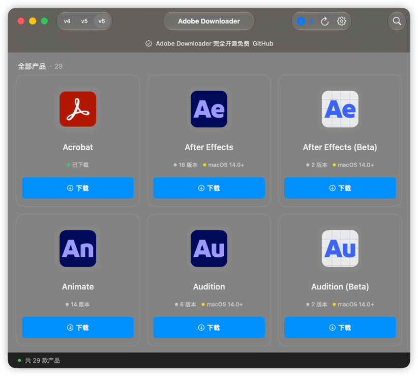

# Adobe Downloader

> Adobe Downloader 中的所有 Adobe 应用均来自 Adobe 官方渠道，并非破解版本。

<a href="https://star-history.com/#X1a0He/Adobe-Downloader&Timeline">
 <picture>
   <source media="(prefers-color-scheme: dark)" srcset="https://api.star-history.com/svg?repos=X1a0He/Adobe-Downloader&type=Timeline&theme=dark" />
   <source media="(prefers-color-scheme: light)" srcset="https://api.star-history.com/svg?repos=X1a0He/Adobe-Downloader&type=Timeline" />
   
 </picture>
</a>

# **[English version](readme-en.md)**

## 使用须知

**⚠️仅支持 macOS 13.0+**

> **如果你也喜欢 Adobe Downloader, 或者对你有帮助, 请 Star 仓库吧 🌟, 你的支持是我更新的动力**

## 📔 最新日志

### 2026-10-16 v3.2.0 更新日志

- feat: 优化版本选择与自定义下载页面，完善版本搜索、安装包筛选和依赖展示
- feat: 优化下载任务卡片与安装包列表，更清晰地展示下载状态、进度和失败信息
- feat: 完善 Helper 授权引导与故障诊断，区分等待授权、注册失败和连接失败，并支持备份迁移旧版 Helper
- feat: 改进 Helper 执行日志和诊断命令的输出、超时及取消处理
- feat: 完善简体中文和英文界面、状态提示与错误信息，统一语言选择和文本格式
- fix: 加强下载文件完整性校验，完善暂停、恢复及任务状态持久化，避免将未完成或损坏的文件当作可安装材料
- fix: 修复 v4 产品目录拉取失败的问题，完善不同接口版本的产品、依赖和架构解析
- fix: 完善全量与增量安装的材料校验、补丁处理和取消流程，改进异常情况下的文件回滚与数据库状态恢复
- fix: 完善卸载事务、共享依赖与模块记录处理，并保留修复和卸载所需的资源
- fix: 修复 Hosts 清理误拦截的问题，清理前保留备份，并在执行结果中显示恢复位置

### 语言支持

- [x] 中文
- [x] English

## ⚠️ 注意

**如果你对 Adobe Downloader 有任何优化建议或疑问，请提出 issue 或通过 Telegram 联系 [@X1a0He](https://t.me/X1a0He_bot)**

## ✨ 特点

- [x] 基本功能 📦
    - [x] 所有 Adobe App 的下载/安装
    - [x] 支持多个产品同时下载
    - [x] 支持使用默认语言和默认目录
    - [x] 支持任务记录持久化
- [x] 安装功能 📦
- [x] 清理功能 🧹 (1.5.0新增)
    - [x] Adobe 应用程序
    - [x] Adobe Creative Cloud
    - [x] Adobe 偏好设置
    - [x] Adobe 缓存文件
    - [x] Adobe 许可文件
    - [x] Adobe 日志文件
    - [x] Adobe 服务
    - [x] Adobe 钥匙串
    - [x] Adobe 正版验证服务
    - [x] Adobe Hosts

## 👀 预览

## 👨🏻‍💻作者

Adobe Downloader © X1a0He

Released under GPLv3. Created on 2024.11.05.

> GitHub [@X1a0He](https://github.com/X1a0He/) \
> Telegram [@X1a0He](https://t.me/X1a0He_bot)
